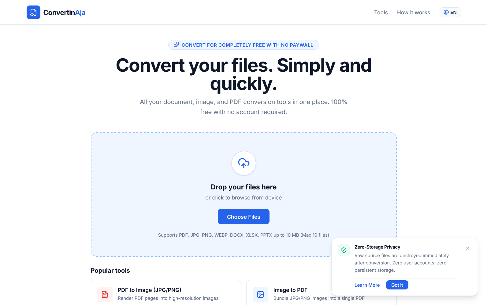

# ConvertinAja

> **Fast, Free & Zero-Storage Web Document and Image Optimization Platform.**  
> Convert PDF, Image, and Office files directly in your browser without accounts, tracking, or server data retention.

- **Official Website:** [https://convertinaja.faridahmad.dev](https://convertinaja.faridahmad.dev)  
- **Developer:** [Farid Ahmad](https://faridahmad.dev)

---

## What's New: High-Performance Image Optimization Module

ConvertinAja now features a dedicated **Image Optimization Engine** built on `libvips` CLI streaming with automatic Go standard library fallback:

1. **Smart Image Compression:**  
   Achieves up to 70–85% file size reduction without perceptible quality loss using perceptual DCT quantization, adaptive chroma subsampling (4:2:0), and optimized Huffman coding tables. Original pixel dimensions are preserved by default.
2. **Target File Size Optimization (Bounded Candidate Search):**  
   Target exact thresholds (≤ 100 KB, ≤ 300 KB, ≤ 500 KB, ≤ 1 MB, or custom KB/MB). An intelligent bounded search algorithm tests compression parameters within 2–4 iterations to guarantee your file meets strict upload quotas (e.g. government, CPNS, academic, or corporate portals).
3. **Smart Resize & Dimension Guardrails:**  
   Downscale large photos using presets (1920px, 1600px, 1280px, 1080px, or custom max dimension) while locking aspect ratio. Automatic upscaling prevention ensures small images are never blown up or degraded.
4. **Format Transcoding:**  
   Convert seamlessly across JPEG, PNG, modern WebP, and next-gen AVIF formats with full alpha transparency preservation where supported.
5. **Interactive Before/After Comparison:**  
   Evaluate results before downloading using a dual-mode visualizer:
   - **Split Slider:** Native interactive sliding divider with `clip-path` inspection.
   - **Side-by-Side:** Direct side-by-side sharpness and color contrast comparison.
6. **Privacy Protection & EXIF/GPS Stripping:**  
   Sensitive digital footprint data (GPS coordinates, altitude, device model, aperture, software ID) is permanently stripped from image headers during optimization. An interactive inspection panel displays all removed tags.

---

## Core Values

1. **Zero-Storage Policy:**  
   ConvertinAja never retains your documents or images. Raw uploaded files are deleted immediately from the server upon processing. Converted and optimized outputs reside in short-lived ephemeral memory and are automatically purged after 5 minutes.
2. **No User Accounts:**  
   Zero registration, email collection, passwords, or user profiling. Anonymous sessions are secured using short-lived UUID tokens.
3. **5-Minute Execution Ceiling:**  
   To prevent server resource starvation and ensure stable VPS operations, all conversions have a strict timeout before automatic termination.
4. **Print-Grade HD & Perceptual Visual Clarity:**  
   PDF-to-image rendering defaults to 300 DPI high resolution; image compression defaults to balanced visual quality preservation.
5. **Open Source & Transparent:**  
   The entire platform codebase is open source under the MIT License.

---

## Conversion Engines & Open-Source Attribution

ConvertinAja operates as an independent web orchestration layer and respects all upstream open-source software licenses:

- **[libvips](https://www.libvips.org/)** (`vips`, `vipsthumbnail`) — LGPL-2.1+ License. High-speed streaming image optimization, bounded search target sizing, aspect-ratio scaling, and metadata stripping without CGO overhead.
- **[Poppler Utilities](https://poppler.freedesktop.org/)** (`pdftoppm`, `pdfunite`, `pdfseparate`, `pdftotext`, `pdfimages`) — GPLv2 / GPLv3 License. Isolated CLI subprocess execution for high-res PDF rendering.
- **[Ghostscript](https://www.ghostscript.com/)** (`gs`) — AGPLv3 License (Artifex Software, Inc.). CLI subprocess execution for PDF stream compression.
- **[LibreOffice Headless](https://www.libreoffice.org/)** (`soffice`) — MPL-2.0 / LGPLv3+ License. Headless document conversions (DOCX, XLSX, PPTX, ODT) to PDF.
- **[WebP Tools](https://chromium.googlesource.com/webm/libwebp)** (`cwebp`, `dwebp`) — BSD-3-Clause License (Google LLC). WebP image encoding and decoding.

---

## Conversion Tools Catalog

- **Image Tools:**
  - **Smart Optimize:** Automatic visual-fidelity compression with WebP/JPEG auto-selection.
  - **Compress Image:** Target file size optimization (≤ 100 KB, ≤ 300 KB, ≤ 500 KB, ≤ 1 MB, custom).
  - **Resize Image:** Proportional dimension scaling (1920px, 1600px, 1280px, 1080px, custom).
  - **Convert Image:** Format transcoding between JPG, PNG, WebP, and AVIF.
  - **Image to PDF:** Combine multiple pictures into a clean PDF document.
- **PDF Tools:** Merge PDF, Split PDF, Compress PDF, PDF to JPG, PDF to PNG, PDF to Text, PDF to Markdown, PDF to HTML, Extract PDF Images.
- **Office Tools:** DOCX to PDF, XLSX to PDF, PPTX to PDF, ODT to PDF, TXT to PDF.

---

## License

ConvertinAja is free, open-source software licensed under the [MIT License](LICENSE).

Upstream binary tools used by this platform retain their respective licenses:
- **libvips** is licensed under LGPL-2.1+.
- **Poppler Utilities** are licensed under GPLv2 / GPLv3.
- **Ghostscript** is licensed under AGPLv3 (Artifex Software, Inc.).
- **LibreOffice** is licensed under MPL-2.0 / LGPLv3+.
- **WebP Tools** are licensed under BSD-3-Clause (Google LLC).

All external binaries are executed strictly as independent subprocesses via CLI (`exec.CommandContext`) without linking or bundling proprietary modifications, fully compliant with upstream licensing.
